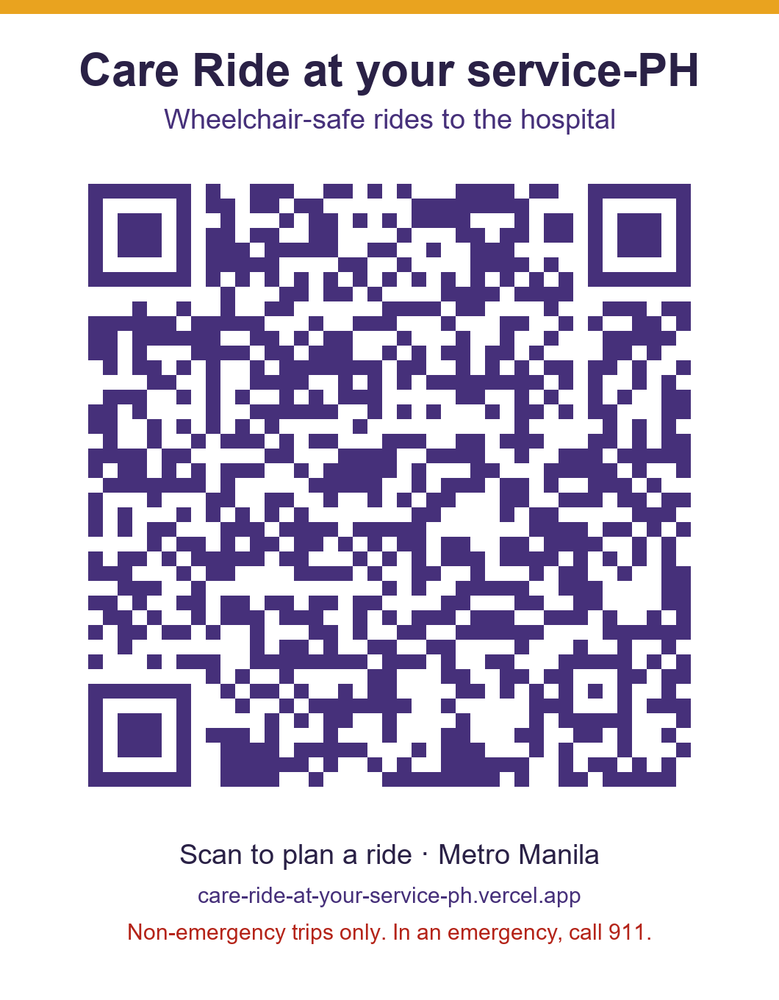

# Launch Plan: How Riders Find Care Ride

**Owner:** Feladel "Peng" Pobre · **Course:** Week 4 Graded Mini Project 4.2 · **Date:** 15 Nov 2026 · **Status:** plan (not yet run)

## Goal
Help caregivers of wheelchair users in Metro Manila find Care Ride when they need a ride to a hospital or dialysis appointment: on social media, where they already ask for help, and in person at the places they already visit.

## 1. QR code

- Opens the live app: https://care-ride-at-your-service-ph.vercel.app (checked with a QR reader).
- Files: [`assets/care-ride-qr-poster.png`](assets/care-ride-qr-poster.png) (printable poster) and [`assets/care-ride-qr.png`](assets/care-ride-qr.png) (code only, for posts and slides).
- The poster keeps the safety line: *Non-emergency trips only. In an emergency, call 911.*

**Where to place it (with permission):**

| Place | Why |
|---|---|
| Dialysis centres and hospital out-patient desks | Patients come back every week; caregivers plan the next trip on the spot |
| Barangay health centres and OSCA / PWD offices | Seniors and PWDs register there; the 20% discount is a strong hook |
| Pharmacies and medical-supply shops (wheelchairs, walkers) | Buyers are exactly our users |
| Church and community bulletin boards | Family members who arrange rides for parents |

## 2. Hashtags
Hashtags only help on social media posts that carry our link or QR code: people who search or follow a hashtag see the post, then tap the link. Use 5–10 per post, mixing the groups below.

| Purpose | Hashtags |
|---|---|
| **Need** | #WheelchairSupport #WheelchairAccessible #WheelchairUser #AccessibleTransport #MobilityAid |
| **Care / health** | #DialysisPatient #DialysisLife #CaregiverPH #SeniorCitizenPH #ElderlyCare #KidneyHealth |
| **Rights / community** | #PWDPhilippines #InclusivePH #AccessibilityForAll #DisabilityInclusion |
| **Place** | #MetroManila #ManilaPH #QuezonCity #PasigCity #MakatiCity #TaguigCity |
| **Brand** (use on every post) | #CareRidePH #CareRideAtYourService |

## 3. Ready-to-post captions
**Facebook (caregiver groups, barangay pages):**
> Hirap bang magpa-checkup o dialysis si Lola o Lolo na naka-wheelchair? 🦽 Care Ride plans a wheelchair-safe ride in one message: tamang sasakyan, crew for the stairs, pickup time and the price up front. Senior/PWD 20% discount. Scan the QR or tap: care-ride-at-your-service-ph.vercel.app
> #CareRidePH #WheelchairSupport #CaregiverPH #SeniorCitizenPH #DialysisPatient #MetroManila

**Instagram (post with the QR poster):**
> Hospital trips shouldn't be this hard. Tell us about the trip like you'd text family; we plan the right van, the crew and the pickup time. 💜 Link in bio.
> #CareRidePH #WheelchairAccessible #AccessibleTransport #PWDPhilippines #ElderlyCare #ManilaPH

**TikTok (15-second screen recording of booking a ride):**
> POV: You book a wheelchair-safe ride to dialysis in one message 🦽✨ #CareRidePH #WheelchairSupport #DialysisLife #CaregiverPH #InclusivePH

## 4. Known limitation and v2 fix
The "I am human" check (Cloudflare Turnstile) sits in front of the whole app to stop fake ride requests. A side effect: Google Search and Facebook/Messenger can't read the home page, so shared links show **no preview** and the site won't rank in search. I accepted this for v1 because stopping bots matters more for a booking service than search traffic.
**v2:** add a small public page (for example `/share`) with the description, a preview image, the QR code and an "Open the app" button. Search engines and link previews can read it, while booking stays behind the human check.

## 5. How we'll measure it
| Metric | Source | Target (first month) |
|---|---|---|
| Visits from QR scans and social posts | Vercel Analytics (visitors, referrers) | 200 visits |
| Trips planned ("Plan my ride") | Dispatcher **Insights** panel | 60 plans |
| Requests sent (conversion) | Dispatcher **Insights** panel | ≥ 40% of plans, as in the PRD |
| Which hashtags and places work | Ask "How did you hear about us?" on the confirmation call | Keep the top 3, drop the rest |
